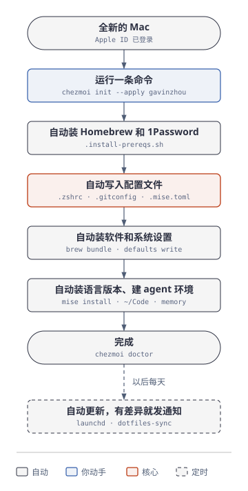

# dotfiles

Gavin 的 Mac 配置，由 [chezmoi](https://www.chezmoi.io/) 管理。

## 新 Mac

登录 Apple ID 后，在终端运行：

```sh
sh -c "$(curl -fsLS get.chezmoi.io)" -- -b ~/.local/bin init --apply --use-builtin-git true --source ~/Code/gavin/dotfiles gavinzhou
```



中途需要你做的事：

1. 装 Homebrew 时输入一次开机密码。
2. 系统弹窗时，给 Karabiner 打开「辅助功能」等权限。
   左右 ⌘ 单按切换英数/かな的规则来自仓库，只在本机还没有 `~/.config/karabiner/karabiner.json` 时写入；之后在 Karabiner 里改的设置留在本机，不会被覆盖。
3. 运行 `gh auth login`，再运行一次 `chezmoi apply`，记忆仓库就会克隆到 `~/.agents/memory`。

## 平时

| 想做的事 | 命令 |
|---|---|
| 改配置文件 | `chezmoi edit ~/.zshrc`，然后 `chezmoi apply` |
| 加一个软件 | 在 `Brewfile` 里加一行，然后 `chezmoi apply` |
| 看本机和仓库差在哪 | `chezmoi diff` |
| 立刻同步一次 | `dotfiles-sync` |

每天 10:00，`dotfiles-sync`（launchd）会拉取仓库更新，**只有每个新提交都带着 Gavin 的签名时才会自动应用**。下面几种情况它只发系统通知、不自动更新：有没签名的提交、本机配置被改过、仓库不在干净的 master。装了 Brewfile 以外的软件，或者 Brewfile 里有软件没装上，也会发通知。日志在 `~/Library/Logs/dotfiles-sync.log`。

## 合并 PR（签名）

这个仓库的提交用 1Password 里的 SSH 密钥签名（库 `gavin`，每次签名都要按 Touch ID）。GitHub 网页上的合并按钮会生成新的提交，这些提交没有 Gavin 的签名，每天的同步就不会应用。所以审查通过后，要在本地快进合并：

```sh
git switch master && git merge --ff-only <分支> && git push origin master
```

分支落后于 master 时，先 `git rebase master`（rebase 会重新签名）。

## 仓库里有什么

| 文件 | 作用 |
|---|---|
| `dot_zshenv` | 环境变量和 PATH。所有 zsh 都会读，包括 agent 用的 `zsh -c`、`zsh -lc`；agent 模式下关掉翻页和颜色，编辑器改成直接失败（`AGENT_SHELL=0` 可关闭 agent 模式） |
| `dot_zprofile` | 登录 shell 里重新设置 PATH，恢复被 `/etc/zprofile` 打乱的顺序 |
| `dot_zshrc` | 只给人用的交互设置：提示符、补全、别名 |
| `dot_gitconfig`、`dot_digrc`、`dot_mise.toml` | 写到 `~/` 下的其他配置文件 |
| `run_onchange_after_15-remove-prezto.sh` | 删掉 Prezto 留下的 `~/.zlogin` 链接（只在它指向 `~/.zprezto` 时才删） |
| `dot_gitconfig-sign-commits`、`dot_git_allowed_signers` | 本仓库提交必须签名；签名验证用的公钥 |
| `Brewfile` | 软件清单 |
| `.install-prereqs.sh` | 每次运行 chezmoi 前执行，确保 Homebrew 和 1Password 已安装 |
| `run_onchange_after_05-secrets.sh.tmpl` | `secrets.zsh.tpl` 改动后，用 `op inject` 从 1Password 生成 `~/.secrets.zsh` |
| `run_onchange_after_10-brew-bundle.sh.tmpl` | Brewfile 改动后装软件 |
| `run_onchange_after_20-macos.sh` | 系统设置：Dock、Finder、轻点点按、大写锁定键改 Control |
| `run_onchange_after_25-1password-ssh.sh` | 让 1Password SSH agent 提供 `gavin` 库里的密钥 |
| `run_onchange_after_30-mise.sh.tmpl` | 装 node、python、terraform |
| `dot_claude/CLAUDE.md`、`dot_codex/AGENTS.md` | Claude Code 和 Codex 的全局入口，只指向记忆仓库里的规则 |
| `claude-settings.json` + `dot_claude/modify_settings.json.tmpl` | Claude Code 的共用设置，合并进 `~/.claude/settings.json`；没列在里面的键（`autoMode` 和 Claude 自己加的）留在本机 |
| `codex-config.toml` + `dot_codex/modify_private_config.toml.tmpl` | Codex 的共用设置，合并进 `~/.codex/config.toml`（权限 600）；Codex 应用自己写的键留在本机。MCP 密钥只在缺失时从 1Password 读（新 Mac） |
| `dot_agents/dot_skill-lock.json` | `npx skills` 装过的技能清单 |
| `test-agent-config.sh` | 上面两个合并脚本的测试（CI 里跑） |
| `run_after_40-agents.sh` | 建 `~/Code/<组>`，装 Claude Code，克隆记忆仓库 |
| `run_onchange_after_50-dotfiles-sync.sh` | 安装每天的自动同步任务 |
| `wt` + `run_onchange_after_60-wt.sh.tmpl` | 有负责人的 git worktree 命令，装到 `~/.local/bin/wt`，并安装每天 9:30 的清扫任务（见下面「worktree」） |
| `test-wt.sh` | `wt` 的测试（CI 里用 bash 和 macOS 自带的 bash 3.2 各跑一次） |

## worktree

每个 worktree 都有一个负责的 agent：要用时建，用完由它删。规则在记忆仓库的 `GLOBAL_RULES.md`。

| 想做的事 | 命令 |
|---|---|
| 建一个（Codex、人；Claude 用自带的 `claude -w` / `EnterWorktree`） | `wt new <名字> --task <仓库#Issue>` |
| 做完删掉（先推送只在这里的提交） | `wt done [<名字>]`，有未提交改动时会拒绝，确认不要再加 `--discard` |
| 看本仓库 / 所有仓库的 worktree 和负责人 | `wt list` / `wt list --all` |
| 只看没人负责、还有未保存内容的 | `wt list --all --attention` |

- 位置固定在 `<仓库>/.claude/worktrees/<名字>`，分支 `worktree-<名字>`，和 Claude Code 自带的一样。别的位置的 worktree（如 codex-fleet 的）`wt` 不管。
- 负责人记在 git 锁的说明里，格式和 Claude Code 自己的锁一样：`(pid 进程号 start 进程启动时间)`。进程号和启动时间都对得上，才算负责人还在。
- 每天 9:30 `wt sweep --notify`：负责人已不在、而且干净的，删掉；其余的不删，发系统通知。日志在 `~/Library/Logs/wt-sweep.log`。
  - 「干净」是指：没有未提交改动（不受仓库 `status.showUntrackedFiles` 设置影响），没有被 git 忽略的文件（`.env`、笔记等；`node_modules`、`.venv`、`dist`、`build` 这类能重新生成的目录不算），也没有只在这里的提交。任何检查失败都算不干净。
  - 没登记负责人的，一小时内不动。目录被手动删掉的只报告，不清理（它的索引和 HEAD 里可能还有东西）。
  - `ps` 用不了（比如在沙箱里）时，不判断负责人是否还在，什么都不删。
- Claude 会话结束时，插件 worktree-keeper 运行 `wt sweep --mine`，删掉本会话负责、而且干净的 worktree。

## 技能

`npx skills` 装的技能记录在 `~/.agents/.skill-lock.json`（每条都有来源地址），换电脑时照着 `npx skills add <来源>` 重装。下面这些不是用 `npx skills` 装的，lock 里没有：

| 技能 | 来源 | 怎么装 |
|---|---|---|
| agents-sdk、cloudflare、cloudflare-email-service、cloudflare-one、cloudflare-one-migrations、durable-objects、nextjs-on-cloudflare、sandbox-migrate-to-next、sandbox-next、sandbox-stable、turnstile-spin、web-perf、workers-best-practices、wrangler | [cloudflare/skills](https://github.com/cloudflare/skills) | `npx skills add cloudflare/skills` |
| sandbox-sdk | 以前的 cloudflare/skills，现在仓库里已经没有 | 不再安装，改用 sandbox-next / sandbox-stable |
| pdftext | [warrenzhu050413/warren-claude-code-plugin-marketplace](https://github.com/warrenzhu050413/warren-claude-code-plugin-marketplace)（`claude-context-orchestrator/snippets/local/productivity/pdftext`） | 把这个目录复制到 `~/.agents/skills/pdftext` |
| easyeda-agent | [zhoushoujianwork/easyeda-agent](https://github.com/zhoushoujianwork/easyeda-agent) | 按该仓库 README 的方式安装 |
| colorfigures | [april-zhu.com/colorfigures](https://april-zhu.com/colorfigures) | 按该页面的安装命令解压到 `~/.claude/skills` |

`~/.claude/skills/synced` 是 Claude 应用自己同步的插件技能，不用管。

## 不放进仓库的东西

这个仓库是公开的。密钥和只属于这台机器的设置放在：

- `~/.secrets.zsh`（权限 600）：token 等密钥。由 `secrets.zsh.tpl` 从 1Password 生成，仓库里只有引用，没有值。
- `~/.zshenv.local`：不是密钥、但也不适合公开的环境变量（所有 zsh 都会读，只能写变量赋值）。
- `~/.zshrc.local`：只给交互终端用的本机设置。
- `~/.claude/settings.json` 的 `autoMode`：写了内部仓库和生产环境的说明，只留在本机。
- `~/.codex/config.toml` 里的 MCP 密钥：在 1Password（库 `gavin`，条目「dotfiles/.secrets.zsh」）。
- `~/.ssh/config`：主机清单。SSH 密钥在 1Password（库 `gavin`）里，经由 1Password 的 SSH agent 使用。
- GitHub 的拉取和推送：`~/.gitconfig` 把 `git@github.com:` 地址自动改成 HTTPS，用 `gh` 的令牌（在钥匙串里），不经过 1Password。1Password 只用于连远程 Mac 和本仓库的提交签名。令牌要有 `workflow` 权限，否则推送改了 `.github/workflows` 的提交会被拒；新 Mac 登录后跑 `gh auth refresh -h github.com -s workflow`，用 `gh auth status` 确认。
