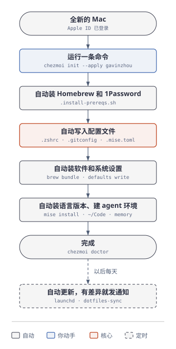

# dotfiles

Gavin 的 Mac 配置，由 [chezmoi](https://www.chezmoi.io/) 管理。

## 新 Mac

登录 Apple ID 后，在终端运行：

```sh
sh -c "$(curl -fsLS get.chezmoi.io)" -- -b ~/.local/bin init --apply --use-builtin-git true --source ~/Code/gavin/dotfiles gavinzhou
```



中途需要你做的事：

1. 装 Homebrew 时输入一次开机密码。
2. 系统弹窗时，给 Karabiner、Ghostty 打开「辅助功能」等权限。
3. 运行 `gh auth login`，再运行一次 `chezmoi apply`，记忆仓库就会克隆到 `~/.agents/memory`。

## 平时

| 想做的事 | 命令 |
|---|---|
| 改配置文件 | `chezmoi edit ~/.zshrc`，然后 `chezmoi apply` |
| 加一个软件 | 在 `Brewfile` 里加一行，然后 `chezmoi apply` |
| 看本机和仓库差在哪 | `chezmoi diff` |
| 立刻同步一次 | `dotfiles-sync` |

每天 10:00，`dotfiles-sync`（launchd）会拉取仓库更新，**只有每个新提交都带着 Gavin 的签名时才会自动应用**。下面几种情况它只发系统通知、不自动更新：有没签名的提交、本机配置被改过、仓库不在干净的 master。装了 Brewfile 以外的软件，或者 Brewfile 里有软件没装上，也会发通知。日志在 `~/Library/Logs/dotfiles-sync.log`。

## 合并 PR（签名）

这个仓库的提交用 1Password 里的 SSH 密钥签名（库 `gavin`，每次签名都要按 Touch ID）。GitHub 网页上的合并按钮会生成新的提交，这些提交没有 Gavin 的签名，每天的同步就不会应用。所以审查通过后，要在本地快进合并：

```sh
git switch master && git merge --ff-only <分支> && git push origin master
```

分支落后于 master 时，先 `git rebase master`（rebase 会重新签名）。

## 仓库里有什么

| 文件 | 作用 |
|---|---|
| `dot_zshenv` | 环境变量和 PATH。所有 zsh 都会读，包括 agent 用的 `zsh -c`、`zsh -lc`；agent 模式下关掉翻页和颜色，编辑器改成直接失败（`AGENT_SHELL=0` 可关闭 agent 模式） |
| `dot_zprofile` | 登录 shell 里重新设置 PATH，恢复被 `/etc/zprofile` 打乱的顺序 |
| `dot_zshrc` | 只给人用的交互设置：提示符、补全、别名 |
| `dot_gitconfig`、`dot_digrc`、`dot_mise.toml` | 写到 `~/` 下的其他配置文件 |
| `run_onchange_after_15-remove-prezto.sh` | 删掉 Prezto 留下的 `~/.zlogin` 链接（只在它指向 `~/.zprezto` 时才删） |
| `dot_gitconfig-sign-commits`、`dot_git_allowed_signers` | 本仓库提交必须签名；签名验证用的公钥 |
| `Brewfile` | 软件清单 |
| `.install-prereqs.sh` | 每次运行 chezmoi 前执行，确保 Homebrew 和 1Password 已安装 |
| `run_onchange_after_05-secrets.sh.tmpl` | `secrets.zsh.tpl` 改动后，用 `op inject` 从 1Password 生成 `~/.secrets.zsh` |
| `run_onchange_after_10-brew-bundle.sh.tmpl` | Brewfile 改动后装软件 |
| `run_onchange_after_20-macos.sh` | 系统设置：Dock、Finder、轻点点按、大写锁定键改 Control |
| `run_onchange_after_25-1password-ssh.sh` | 让 1Password SSH agent 提供 `gavin` 库里的密钥 |
| `run_onchange_after_30-mise.sh.tmpl` | 装 node、python、terraform |
| `run_after_40-agents.sh` | 建 `~/Code/<组>`，装 Claude Code，克隆记忆仓库 |
| `run_onchange_after_50-dotfiles-sync.sh` | 安装每天的自动同步任务 |

## 不放进仓库的东西

这个仓库是公开的。密钥和只属于这台机器的设置放在：

- `~/.secrets.zsh`（权限 600）：token 等密钥。由 `secrets.zsh.tpl` 从 1Password 生成，仓库里只有引用，没有值。
- `~/.zshenv.local`：不是密钥、但也不适合公开的环境变量（所有 zsh 都会读，只能写变量赋值）。
- `~/.zshrc.local`：只给交互终端用的本机设置。
- `~/.ssh/config`：主机清单。SSH 密钥在 1Password（库 `gavin`）里，经由 1Password 的 SSH agent 使用。
